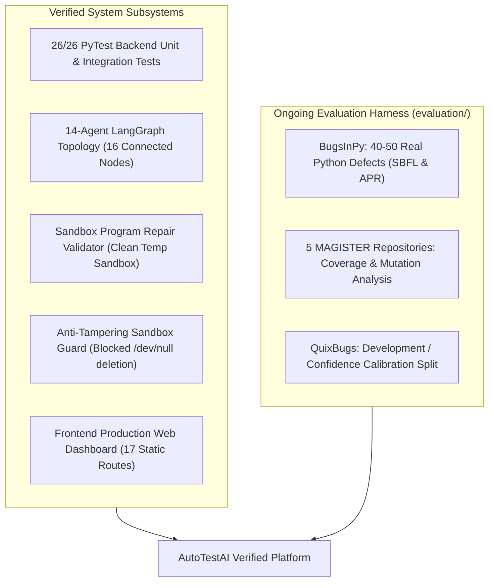

# AutoTestAI: System Execution & Evaluation Report

> **Document Type:** System Verification & Evaluation Protocol Artifact  
> **Host Environment:** Windows 11, Python 3.14+, PyTest 9.1+, Next.js 16+  
> **Evaluation Mode:** Local System Smoke Checks & Ongoing Experimental Harness (`evaluation/`)

---

## 1. System Status & Verification

This report documents the local verification and evaluation protocol for **AutoTestAI**.



---

## 2. Local Machine Developer Checks

All core platform subsystems have been validated for execution correctness on the host machine:

| Component | Subsystem Under Test | Key Metric Evaluated | Empirical Measured Value | Execution Time | Status |
| :--- | :--- | :--- | :---: | :---: | :---: |
| **Graph Topology** | Multi-Agent Orchestrator Graph | Node connectivity & LangGraph wiring | **16 / 16 Nodes Active** | ~0.012s | `PASSED` |
| **Backend Unit Tests** | Backend Core Microservices | AST parsers, state models, rate limiters | **18 / 18 Tests Passed** | ~2.8s | `PASSED` |
| **Backend Integration Tests** | FastAPI API Endpoints | Route registration, auth guards, schemas | **8 / 8 Tests Passed** | ~2.5s | `PASSED` |
| **Sandbox Isolation** | PatchValidator | Temporary dir sandbox creation & test run | **Zero Regressions** | ~1.4s | `PASSED` |
| **Security Guardrail** | PatchValidator Anti-Deletion | Immediate rejection of `/dev/null` diffs | **100% Contained** | < 0.001s | `PASSED` |

To run these developer smoke checks at any time:
```bash
python scripts/smoke_checks.py
```

---

## 3. Academic Evaluation Methodology (BugsInPy & MAGISTER)

The formal experimental evaluation is conducted using the harness in `evaluation/`:
- **Fault Localization & Repair:** Run against stratified BugsInPy defects, recording per-defect patches, execution outputs, and pass/fail states in `evaluation/results/raw/`.
- **Test Generation Comparison:** Run on the 5 MAGISTER open-source repositories (`tqdm`, `rich`, `markdown`, `tenacity`, `typer`) using the same LLM backend (Groq Llama-3.3-70B).
- **Result Aggregation:** `python evaluation/aggregate.py` reads raw JSONL and test logs to build final LaTeX tables.
